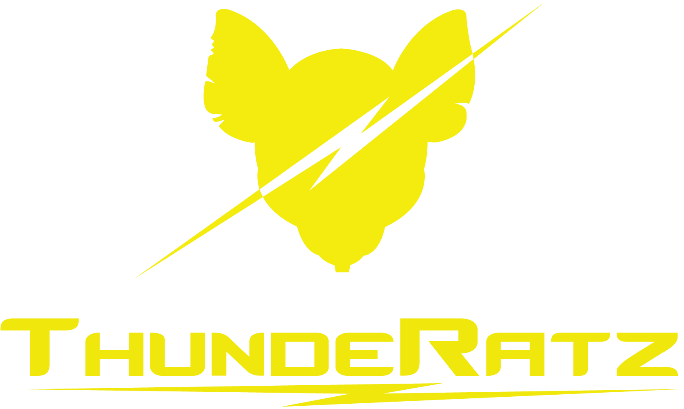

  

<h1 align="center">ThundeRatz</h1>

  <strong>Equipe de robótica da Escola Politécnica da Universidade de São Paulo (Poli-USP)</strong>

  <a href="https://thunderatz.org/">Site</a> ·
  <a href="https://www.instagram.com/thunderatz/">Instagram</a> ·
  <a href="https://www.linkedin.com/company/thunderatz-equipe-de-rob-tica/">LinkedIn</a> ·
  <a href="mailto:contato@thunderatz.org">Contato</a>

  
  
  
  
  

## Sobre a ThundeRatz

A **ThundeRatz** é uma equipe universitária de robótica formada por estudantes da Poli-USP. Desenvolvemos robôs, sistemas embarcados e soluções de software para competições, pesquisa e formação prática em engenharia.

Nossa organização reúne projetos criados ao longo da história da equipe — de bibliotecas para microcontroladores a ferramentas de simulação, visão computacional, controle e infraestrutura. Compartilhamos parte desse conhecimento em código aberto para que outras pessoas possam aprender, reutilizar e contribuir.

## O que fazemos

- 🤖 **Robótica móvel e autônoma**
- ⚽ **Futebol de robôs e simulação**
- 🔩 **Sistemas embarcados e firmware**
- 🧭 **ROS, Gazebo e ferramentas de simulação**
- 👁️ **Visão computacional e inteligência artificial**
- 🛠️ **Eletrônica, controle e infraestrutura de software**

## Projetos em destaque

| Projeto                                                                        | Descrição                                                                                          |
| ------------------------------------------------------------------------------ | -------------------------------------------------------------------------------------------------- |
| [**STM32Guide**](https://github.com/ThundeRatz/STM32Guide)                     | Guia para programação de microcontroladores da STMicroelectronics.                                 |
| [**STM32ProjectTemplate**](https://github.com/ThundeRatz/STM32ProjectTemplate) | Template para projetos com STM32 e STM32CubeMX.                                                    |
| [**Perse Mujoco**](https://github.com/ThundeRatz/perse_mujoco)                 | Simulação do Perse, nosso robô autônomo da categoria Trekking, utilizando o motor de física MuJoCo |
| [**Perse egui**](https://github.com/ThundeRatz/perse_egui)                     | Interface gráfica de controle e telemetria do Perse                                                |
| [**travesim**](https://github.com/ThundeRatz/travesim)                         | Ambiente de simulação Gazebo para robôs de futebol da categoria IEEE VSS.                          |
| [**ROSGazeboGuide**](https://github.com/ThundeRatz/ROSGazeboGuide)             | Guia de introdução ao ROS e ao Gazebo.                                                             |
| [**STM32RF24**](https://github.com/ThundeRatz/STM32RF24)                       | Biblioteca para comunicação com o módulo de rádio nRF24L01 usando STM32.                           |
| [**STM32MemoryCard**](https://github.com/ThundeRatz/STM32MemoryCard)           | Biblioteca para aplicações com cartões SD em microcontroladores STM32.                             |
| [**T.H.O.R.**](https://github.com/ThundeRatz/T.H.O.R.)                         | ThundeRatz Holistic Operational Robot, nossa infraestrutura de presença virtual.                   |
| [**ThunderSite**](https://github.com/ThundeRatz/ThunderSite)                   | Código do site institucional da equipe.                                                            |

  <a href="https://github.com/ThundeRatz?tab=repositories"><strong>→ Explore todos os repositórios públicos</strong></a>

## Para quem quer contribuir

Encontrou um projeto interessante? Sinta-se à vontade para abrir uma issue, propor uma melhoria ou enviar um pull request. Antes de contribuir, confira o `README` e as orientações específicas do repositório.

> Projetos antigos podem estar arquivados ou sem manutenção ativa. Consulte o repositório correspondente para conhecer seu estado atual, dependências e licença.

## Fale conosco

- ✉️ [contato@thunderatz.org](mailto:contato@thunderatz.org)

  Feito com ⚡ pela ThundeRatz

